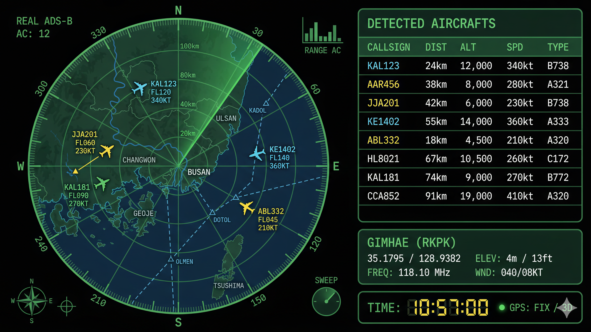

# 📡 ESP32-S3 Realtime ADS-B Airplane Radar (Gimhae / RKPK)

CrowPanel 7.0" (ESP32-S3, 800×480 RGB) 디스플레이 기반의 **실시간 항공기 레이더(ADS-B) 시각화 프로젝트**입니다.  
김해국제공항(RKPK)을 중심으로 반경 100km 이내의 실시간 항공기 위치, 고도, 속도, 진행 방위각을 수신하여 **사전 렌더링된 컬러 지형도 및 표준 계기 접근·출발 항로(STAR/SID)** 위에 관제 레이더(ATC) 스타일로 표시합니다.

---

## ✨ 주요 기능

* **실시간 ADS-B 항공 데이터 수신 (`api.adsb.lol`)**
  * FreeRTOS 백그라운드 태스크(`xTaskCreatePinnedToCore`, Core 0)를 통해 네트워크 API 호출과 JSON 파싱을 비동기로 처리하여, 스윕 애니메이션의 프레임 저하 없이 부드러운 40fps 화면을 유지합니다.
* **사전 렌더링 컬러 벡터 지형도 (`mapSprite`)**
  * PSRAM 오프스크린 버퍼(`480×480`)에 남해안·동해안 해안선, 거제도·남해도·대마도, 낙동강 수계, 주요 간선축(경부·남해선) 및 주요 도시 라벨을 부팅 시 1회 사전 렌더링하여 고속 DMA 복사로 출력합니다.
* **김해국제공항(RKPK) STAR/SID 항로 및 웨이포인트**
  * 주요 접근·출발 항로선(점선) 및 핵심 픽스(`KADOL`, `TOPAX`, `DOTOL`, `DALSU`, `OLMEN`, `KAMIT`, `USN`)를 항공 차트 표준 심볼로 표시합니다.
* **회전형 비행기 아이콘 & 고도별 컬러 코딩**
  * 항공기의 실제 진행 방위(`trackDeg`)에 맞춰 회전하는 비행기 실루엣 아이콘과 속도 벡터선을 렌더링합니다.
  * 고도에 따른 직관적인 색상 구분:
    * 🔵 **30,000 ft 이상** (고고도 순항): 스카이 블루
    * 🟢 **10,000 ~ 29,999 ft** (중고도 상승/강하): 브라이트 그린
    * 🟡 **10,000 ft 미만** (저고도 접근/이륙): 앰버 옐로우
    * 🔴 **고도 정보 없음**: 레드
* **우측 통합 관제 정보 패널**
  * 기준 공항에서 가까운 순으로 상위 10개 항공기의 편명(Callsign), 거리(km), 고도(ft), 대지속도(kt), 기종 코드 실시간 리스트 출력
  * 한국 표준시(KST, `pool.ntp.org`) NTP 동기화 디지털 시계

---

## 🛠 하드웨어 및 개발 환경

* **MCU / Board:** Elecrow CrowPanel 7.0" HMI ESP32-S3 (800×480 RGB Parallel Interface, 8MB+ PSRAM 필수)
* **Framework:** Arduino IDE / PlatformIO (`esp32` board package)
* **필수 라이브러리:**
  * [`LovyanGFX`](https://github.com/lovyan03/LovyanGFX) (v1.x 이상)
  * [`ArduinoJson`](https://github.com/bblanchon/ArduinoJson) (v6.x 이상)
  * `WiFi`, `HTTPClient`, `WiFiClientSecure`, `Wire` (ESP32 Arduino Core 기본 내장)

---

## ⚙️ 설치 및 설정 방법
* Arduino IDE 보드 설정 (CrowPanel 7.0" ESP32-S3 기준)

  * Board: ESP32S3 Dev Module

  * PSRAM: OPI PSRAM (⚠️ 480×480 16-bit 스프라이트 2개를 사용하므로 반드시 활성화해야 합니다)

  * Partition Scheme: Huge APP (3MB No OTA/1MB SPIFFS)

* 컴파일 및 업로드

🎨 색상 및 레이더 파라미터 커스터마이징
  * 탐지 반경 변경: RADAR_RANGE_KM 및 API_RADIUS_NM 값을 수정하여 탐지 거리를 조정할 수 있습니다. (1 NM ≈ 1.852 km)

  * 스윕 속도 및 잔광 길이: SWEEP_SPEED(ms 단위 갱신 주기)와 TRAIL_WIDTH(잔광 각도)로 레이더 회전감을 조절합니다.

  * 컬러 지도 팔레트: setup() 내의 colSea, colLand, colCoast, colRiver, colAirway RGB565 값을 수정하여 원하는 야간/주간 관제 테마로 변경할 수 있습니다.

📡 데이터 출처 (Data Source)
  * 실시간 항공기 ADS-B 데이터는 adsb.lol Public API (/v2/point/{lat}/{lon}/{radius})를 통해 조회합니다.

  * 본 프로젝트는 교육 및 취미·관측 목적으로 제작되었으며, 실제 항공 항법이나 관제 용도로 사용할 수 없습니다.

